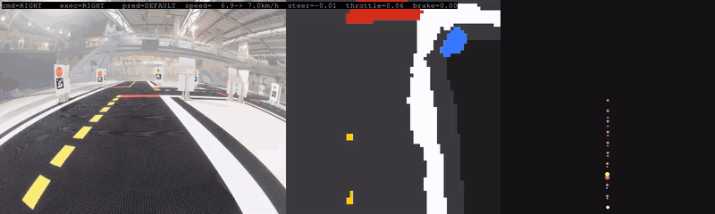

<div align="center">


<h1>DuckAD: An End-to-End Autonomous Driving Pipeline for Duckietown</h1>



<br/>

<p>
  
  
  
  <a href="https://huggingface.co/datasets/pamasan/duckad-data"></a>
</p>

<p>
  <a href="#requirements"><b>Requirements</b></a> &nbsp;·&nbsp;
  <a href="#installation"><b>Installation</b></a> &nbsp;·&nbsp;
  <a href="#quickstart"><b>Quickstart</b></a> &nbsp;·&nbsp;
  <a href="#pipeline"><b>Pipeline</b></a> &nbsp;·&nbsp;
  <a href="#datasets"><b>Datasets</b></a> &nbsp;·&nbsp;
  <a href="#ablation-study"><b>Ablation study</b></a> &nbsp;·&nbsp;
  <a href="#utilities-and-debugging"><b>Utilities</b></a> &nbsp;·&nbsp;
  <a href="#running-on-a-real-duckiebot"><b>Real robot</b></a>
</p>

</div>

DuckAD is a complete, reproducible pipeline for training a vision-based end-to-end driving
model for [Duckietown](https://www.duckietown.org/): expert data collection in
[CARLA-Duckietown](https://github.com/duckietown/carla), imitation training, closed-loop
evaluation back in the simulator, ONNX export for on-robot deployment, and a set of visual
debugging tools for everything in between. The [on-robot client](client/) runs the exported
model on a real Duckiebot, with a live web dashboard.

From a **single front camera image** and a **high-level navigation command**, the model predicts
the future trajectory the Duckiebot should drive.

## Requirements

- Linux x86_64
- Python 3.10 or 3.12
- NVIDIA GPU with CUDA 13.0
- ~70 GB free disk
- [uv](https://docs.astral.sh/uv/)

Data collection and closed-loop evaluation additionally need a **running CARLA-Duckietown
server**. Training, replay and the plotting scripts do not.

## Installation

### 1. Simulator

Install [CARLA-Duckietown 1.0](https://github.com/duckietown/carla/releases/tag/1.0) — our custom
CARLA build with Duckietown maps, Duckiebot vehicles and duck props — following the instructions
on the release page. It is a modified simulator, not an asset pack: the `carla` package from PyPI
will not talk to it.

Start it before any command that talks to the simulator (it listens on `127.0.0.1:2000` by
default, which is what every script here assumes):

```bash
./CarlaUE4.sh
```

### 2. Python environment

```bash
uv sync
```

The CARLA client wheel is fetched straight from the release — `uv` picks the `cp310` or `cp312`
build to match your interpreter, so there is nothing to download by hand. It installs under the
import name `carla`, as usual.

> [!NOTE]
> Python 3.11 is not supported: the release ships `cp310` and `cp312` wheels only.

### 3. Background images for augmentation

Background-swap augmentation (`data.background_aug`) and the "unfamiliar scene → stop" samples
(`optim.imagenet_stop_prob`) sample from the ImageNet-1k validation set (~6.7 GB, 50k images).

```bash
./scripts/setup/fetch_imagenet_kaggle.sh     # -> ./imagenet-val
```

Needs Kaggle credentials — the script header lists the ways to supply them. To download
by hand instead, grab the [ImageNet-1k val set](https://www.kaggle.com/datasets/titericz/imagenet1k-val/data)
and extract it to `imagenet-val/` in the project root. Any nested layout works; the loader just
globs `*.JPEG`.

## Quickstart

Skip data collection entirely — train on the released dataset and drive the result.

```bash
# 1. Fetch the pre-built training + held-out test set (~13 GB, needs ~70 GB free)
./scripts/setup/fetch_data.sh
#    -> data/final/  (840 shards + trajectory_norm.json)
#    -> data/test/   (held-out map06 set)

# 2. Train
uv run python -m src.training.train configs/train_gru.yaml
#    -> checkpoints/gru-<timestamp>/last.pt

# 3. Drive it in CARLA (simulator must be running)
uv run python -m src.eval.run checkpoints/gru-<timestamp>/last.pt --map duckietown_02 --visualize
```

The dataset is also on the Hub as [`pamasan/duckad-data`](https://huggingface.co/datasets/pamasan/duckad-data)
if you only want to browse it.

## Pipeline

The full loop, in order. Steps 1–2 are only needed if you are collecting your own data.

### 1. Record data

> Requires a running CARLA server.

```bash
uv run python -m src.aggregation.collection.collect \
    --duration 60 --segments 10 \
    --map duckietown_02 --hdri-preset lab_01
```

Spawns a Duckiebot driven by the rule-aware expert and ticks the simulation synchronously at
20 Hz. Every timestep is captured from **three camera rigs** (center/left/right — the side rigs
give DAVE-2-style recovery viewpoints, with trajectories transformed into each rig's frame).
Recordings are written as `batch_*.npz` shards to `data/<map>_<hdri>_<capture_time>/`.

Frequently used flags:

| Flag | Effect |
|---|---|
| `--segments N` | Respawn at a fresh location N times — spatial coverage |
| `--junction` | Spawn near junctions, for denser `LEFT`/`STRAIGHT`/`RIGHT` coverage |
| `--traffic N` | Add N expert-driven traffic Duckiebots |
| `--duckies` / `--duckie-obstacle` | Ducks beside the road (visual only) / on the road (expert stops for them) |
| `--camera-yaw-jitter DEG` | Randomize camera mount yaw per segment; labels follow the yawed frame |
| `--temporal-hz` | Temporal trajectory sample rate (3.33 Hz ≈ a 3 s horizon over 10 points) |
| `--out DIR` | Parent directory for the recording |
| `--visualize` | Live pygame preview |

Full list: `uv run python -m src.aggregation.collection.collect --help`

> [!NOTE]
> To train across multiple maps, collect them separately and merge the shards into one folder
> (e.g. `data/train/`). The scripted collection matrix in [Datasets](#datasets) does this for you.

### 2. Normalize trajectories

```bash
uv run python -m src.aggregation.data.normalize data/train --clip-percentile 1
```

Computes trajectory statistics over the **training set** and writes `trajectory_norm.json` into
that directory. The test set is always evaluated with the training set's normalization, so run
this once, on the training data only.

### 3. Train

```bash
uv run python -m src.training.train configs/train_gru.yaml
```

Start from [`configs/train_gru.yaml`](configs/train_gru.yaml) or
[`configs/train_mlp.yaml`](configs/train_mlp.yaml) and edit the run in place:

```yaml
model:
  head: gru                       # gru | mlp

data:
  dir: data/train                 # training shards + trajectory_norm.json
  test_dir: null                  # optional held-out set, scored every epoch
  batch_size: 256
  num_workers: 8                  # parallel data-loading processes
  augment: true                   # photometric image augmentation
  background_aug: true            # random ImageNet background swaps (needs imagenet-val/)

optim:
  epochs: 20
  lr_backbone: 1.0e-5
  lr_head: 1.0e-4
  command_perturb_prob: 0.3       # train turn heads to follow lanes outside junctions
  imagenet_stop_prob: 0.0         # learn zero velocity on random ImageNet images
  train_bev: true                 # BEV auxiliary task

runtime:
  seed: 0
  device: cuda
  runname: gru                    # checkpoints/<runname>-<timestamp>/
```

Each run writes to `checkpoints/<runname>-<timestamp>/`: every epoch as `epochs/epoch_XXX.pt`,
a rolling `last.pt`, `training_curve.png`, and `training_curve.pkl` with the raw per-epoch
metrics.

> [!TIP]
> Training is **CPU-bound on augmentation**, not GPU-bound. `num_workers` is usually what limits
> throughput; budget roughly `num_workers + 1` processes per run.

### 4. Drive the checkpoint

> Requires a running CARLA server.

```bash
uv run python -m src.eval.run checkpoints/<run>/last.pt --map duckietown_02 --visualize
```

Drives the Duckiebot from the model's predictions: steering follows the predicted waypoint at
`--lookahead-index`, and the target speed comes from the model unless you override it with
`--no-use-model-speed --target-speed`.

`--visualize` opens a window showing the camera, predicted BEV and trajectories, where the
**arrow keys** send commands (←/→/↑ = `LEFT`/`RIGHT`/`STRAIGHT`, ↓ = back to `DEFAULT`) and
**WASD/space** take over manually. Other useful flags: `--traffic N`, `--duckies`,
`--duckie-obstacle` to populate the scene, and `--steer-noise` to inject disturbances.

Full list: `uv run python -m src.eval.run --help`

### 5. Score it (closed loop)

```bash
uv run python -m src.eval.closed_loop checkpoints/<run>/last.pt \
    --map duckietown_06 --hdri-preset airport \
    --junction --max-junctions 3 --seeds 0-2 \
    --json-out results.json
```

Scores one or more checkpoints on repeatable seeded routes — a seed fixes both the spawn point
and the command sequence, so every checkpoint faces identical routes. Reports laps completed,
lane departures, cross-track error (mean/RMS/max), junctions taken correctly, and the failure
reason if a run aborts — as JSON.

## Datasets

[`scripts/datasets/`](scripts/datasets/) reproduces the released dataset: a six-condition
collection matrix over the training maps.

```bash
./scripts/datasets/run_all.sh          # everything, in order -> data/final/
./scripts/datasets/03_ducks_roadside.sh # or one condition at a time
```

| Script | Condition | Traffic | Ducks |
|---|---|---|---|
| `01_baseline.sh` | `baseline` | – | – |
| `02_traffic_only.sh` | `traffic_only` | ✓ | – |
| `03_ducks_roadside.sh` | `ducks_roadside` | – | roadside |
| `04_ducks_obstacle.sh` | `ducks_obstacle` | – | on-road |
| `05_ducks_roadside_traffic.sh` | `ducks_roadside_traffic` | ✓ | roadside |
| `06_ducks_obstacle_traffic.sh` | `ducks_obstacle_traffic` | ✓ | on-road |

All shared knobs — maps, segment count, duration, camera yaw jitter, traffic counts, duck
spacing — live in [`scripts/datasets/common.sh`](scripts/datasets/common.sh), each documented
with the reasoning behind its value. Override per run via environment variables:

```bash
DATASET_MAPS="duckietown_04" TRAFFIC_N=2 ./scripts/datasets/02_traffic_only.sh
```

The result is **214,200 training frames** (two maps × six scenarios × three rigs, ≈1 h of expert
driving) plus **10,200 test frames** from an unseen map under unseen lighting. Full field
documentation is in [`scripts/datasets/dataset_card.md`](scripts/datasets/dataset_card.md).

Publish a collection to the Hub with:

```bash
huggingface-cli login
uv run --with datasets --with pillow scripts/datasets/export_hf.py <user>/<dataset-name>
```

## Ablation study

[`scripts/ablation/`](scripts/ablation/) runs a one-factor-at-a-time study off a
GRU + BEV + augmentation + pretrained-backbone baseline — **5 cells**, seed 8743, 15 epochs.

| Cell | Change from baseline |
|---|---|
| `base` | — (GRU head, BEV auxiliary task, augmentation and background swap on, ImageNet-pretrained MobileNet) |
| `mlp` | MLP waypoint head instead of the autoregressive GRU |
| `nopretrain` | MobileNet trained from scratch |
| `nobg` | ImageNet background swap off (photometric augmentation still on) |
| `noaug` | Photometric augmentation and background swap off |

```bash
./scripts/ablation/run_ablation.sh                     # -> checkpoints/<cell>-s<seed>-<timestamp>/
ABL_SEEDS="8743 1553 2971" ./scripts/ablation/run_ablation.sh   # more seeds for mean ± std
```

The runner writes the per-run configs to `configs/ablation/` via
[`gen_configs.py`](scripts/ablation/gen_configs.py) before training, so edit the cells there,
not in the generated YAMLs.

The runner derives its concurrency from core count (the workload is augmentation-bound) and
round-robins runs across available GPUs. Override with
`ABL_SEEDS`, `ABL_EPOCHS`, `ABL_WORKERS`, `ABL_CONCURRENCY`, `ABL_GPUS`.

Closed-loop comparison on the held-out map and lighting, and the result figures:

```bash
./scripts/ablation/eval_junctions.sh              # all cells, 3 seeded routes × 3 junctions
uv run python scripts/ablation/plot_curves.py            # test-loss curves, mean ± std over seeds
uv run python scripts/ablation/plot_domain_gap_traj.py   # sim-to-real trajectory comparison
uv run python scripts/ablation/plot_aug_bev_traj.py      # combined presentation figure
```

## Utilities and debugging

### Replay a recording

```bash
uv run python -m src.aggregation.collection.replay data/<recording> --fps 20 --loop
```

Plays a recording back from disk — camera, BEV and trajectory labels. No CARLA needed.

### Inspect the sim-to-real domain gap

```bash
uv run python -m src.eval.domain_gap checkpoints/<run>/last.pt [more/checkpoints.pt ...]
```

Runs one or more checkpoints over real lab photographs (default `data/lab_images/`) and overlays
their predictions, so you can see how each behaves off-distribution. Press `E` to export the
predictions for [`plot_domain_gap_traj.py`](scripts/ablation/plot_domain_gap_traj.py).

### Check a dataset for imbalance

```bash
uv run python -m src.aggregation.data.balance data/<recording> --k 6
```

Clusters trajectories into `k` modes and reports their distribution — a quick way to catch a
dataset that is 90% straight driving.

### Export to ONNX

```bash
uv run python -m src.onnx.export_onnx checkpoints/<run>/last.pt
uv run python -m src.onnx.demo_onnx <model>.onnx <frame>.jpg   # interactive viewer, arrow keys set the command
```

To drive the exported model on a real robot, see [Running on a real Duckiebot](#running-on-a-real-duckiebot).

### Figures

```bash
uv run python scripts/datasets/plot_scenarios.py      # the three-rig recovery setup
uv run python scripts/datasets/plot_augmentations.py  # augmentation pipeline
```

## Running on a real Duckiebot

[`client/`](client/) is a Duckietown module that runs an exported model on the robot. It
streams the camera through the model, turns the predicted trajectory into wheel commands, and
serves a dashboard on port `8090` for sending navigation commands and tuning the controller
live.

```bash
uv run python -m src.onnx.export_onnx checkpoints/<run>/last.pt \
    -o client/packages/model_node/assets/model.onnx
cd client && DUCKAD_ROBOT=<robot>.local scripts/deploy.sh
#    -> http://<robot>.local:8090
```

Setup, the dashboard, the controller and deployment are covered in the
[client README](client/README.md).

## Authors

- [Paul Masan](https://github.com/Raining-Cloud/)
- [Simon Rappenecker](https://github.com/DerSimi/)

## License

The code is released under the [MIT License](LICENSE). The dataset is released under
[CC-BY 4.0](https://creativecommons.org/licenses/by/4.0/).
