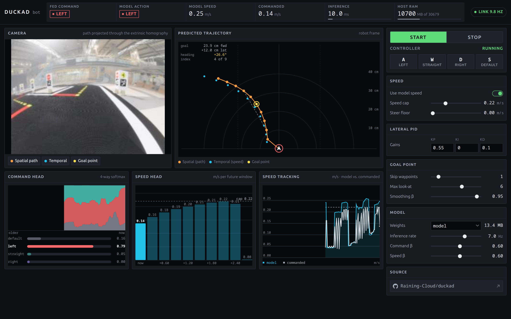

# DuckAD Client

Runs an exported DuckAD model on a real Duckiebot, with a live web dashboard for sending
navigation commands and tuning the controller while it drives.



| Package | Purpose |
|---|---|
| [`model_node`](packages/model_node/) | Runs the ONNX model on the camera feed |
| [`controller_node`](packages/controller_node/) | Turns the predicted trajectory into wheel commands |
| [`web_interface`](packages/web_interface/) | Dashboard on port `8090` |

## Requirements

- Duckiebot (Jetson Nano) on the Duckietown `ente` distribution
- [Duckietown Shell](https://docs.duckietown.com/) (`dts`), laptop and robot on the same network

## Quickstart

```bash
# from the repo root: export a checkpoint into the client
uv run python -m src.onnx.export_onnx checkpoints/<run>/last.pt \
    -o client/packages/model_node/assets/model.onnx

# sync weights, build and run on the robot
cd client
DUCKAD_ROBOT=<robot>.local scripts/deploy.sh
```

Open `http://<robot>.local:8090` and press **Start**. The robot starts stopped.

## Dashboard

| Key | Command |
|---|---|
| <kbd>A</kbd> / <kbd>W</kbd> / <kbd>D</kbd> | `LEFT` / `STRAIGHT` / `RIGHT` at the next junction |
| <kbd>S</kbd> | `DEFAULT` (follow the lane) |

Every parameter in the sidebar applies live. The **Model** card hot-swaps between any `.onnx`
file on the robot.

## Parameters

The smoothing parameters (β) are exponential moving averages: `new = β·latest + (1−β)·old`.
`β = 1` means no smoothing. Lower values are steadier but react more slowly.

**Speed**

| Parameter | Default | Effect |
|---|---|---|
| Use model speed | on | On: drive at the speed predicted from the temporal trajectory, up to the cap. Off: always drive at the cap |
| Speed cap | `0.22 m/s` | Maximum speed |
| Steer floor | `0 m/s` | Below this speed the robot doesn't steer, so it never turns on the spot |

**Lateral PID**

Steers toward the goal point. The error is the heading angle to that point. The output is
rate-limited and clipped before it becomes the angular velocity.

| Parameter | Default | Effect |
|---|---|---|
| kp | `0.55` | Steering strength. Too high oscillates, too low cuts corners wide |
| ki | `0` | Corrects a steady drift to one side. Usually not needed |
| kd | `0.1` | Damps oscillation |

**Goal point**

The controller steers toward one waypoint of the predicted path. Of the waypoints between
*skip* and *max look-at*, it picks the one furthest from the straight line between those two,
i.e. the apex of the curve. On a straight path it picks the last one.

| Parameter | Default | Effect |
|---|---|---|
| Skip waypoints | `1` | Ignore the first N waypoints (too close to steer on) |
| Max look-at | `6` | Furthest waypoint considered. Higher looks further ahead: smoother, but cuts corners |
| Smoothing β | `0.95` | Smoothing of the heading to the goal point |

**Model**

| Parameter | Default | Effect |
|---|---|---|
| Weights | `model.onnx` | ONNX file to run. Driving pauses while it loads |
| Inference rate | `7 Hz` | Predictions per second. Higher is fresher but loads the Nano more |
| Command β | `0.6` | Smoothing of the model's command prediction (Model action) |
| Speed β | `0.6` | Smoothing of the predicted speed profile |

## Weights

Weights are not committed and not baked into the image. They live on the robot at
`/data/duckad/models`, so adding a model needs no rebuild:

```bash
scripts/deploy.sh --sync-only          # push new/changed .onnx files only
ABL_ONNX_DIR=client/packages/model_node/assets ./scripts/ablation/export_onnx.sh   # all ablation cells
```

Models must be exported with `export_onnx` (opset 15, with the normalization metadata the node
needs). For models stamped with a newer opset, run `scripts/convert_opset.py`.

## Configuration

| Variable | Default | Effect |
|---|---|---|
| `DUCKAD_ROBOT` | `canards.local` | Robot for `deploy.sh` |
| `DUCKAD_MODELS_DIR` | `/data/duckad/models` | Where the nodes look for weights |
| `DUCKAD_KEEP_SERVICES` | unset | `1` skips stopping unused Duckietown services at start-up |

> [!NOTE]
> To free memory on the Nano, the client stops unused Duckietown services (including the
> robot's own web dashboard) while it runs and restores them on exit.
